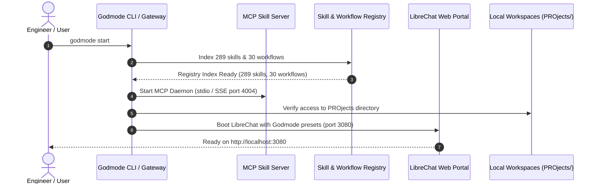
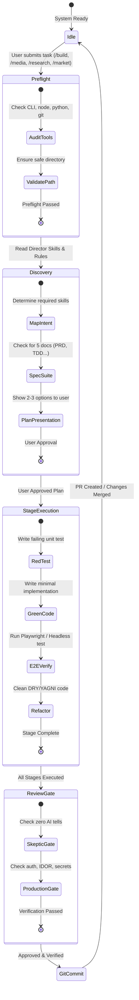

# App Flow & Interaction Graph — GODMODE OS

**Engine:** Rule Zero Pipeline State Machine  
**Event Protocol:** JSON-RPC 2.0 / Server-Sent Events (SSE)

---

## 1. System Lifecycle & Startup Sequence



---

## 2. Pipeline Execution State Machine (Rule Zero)



---

## 3. Tool Intent & Outcome Telemetry Cycle

Every tool call follows the strict 3-beat telemetry protocol:

```
Step 1: Broadcast Intent (Streaming)
{
  "event": "tool_intent",
  "data": {
    "callId": "call_94812",
    "toolName": "workspace_edit",
    "intent": "Adding Stripe webhook verification middleware",
    "status": "RUNNING",
    "costTier": "LOW"
  }
}

Step 2: Execution (Isolated in worktree/sandbox)
... executes changes and runs tests ...

Step 3: Broadcast Outcome (Settled)
{
  "event": "tool_outcome",
  "data": {
    "callId": "call_94812",
    "outcome": "Added Stripe webhook verification middleware with signature tests passing",
    "status": "SUCCESS",
    "durationMs": 142
  }
}
```
